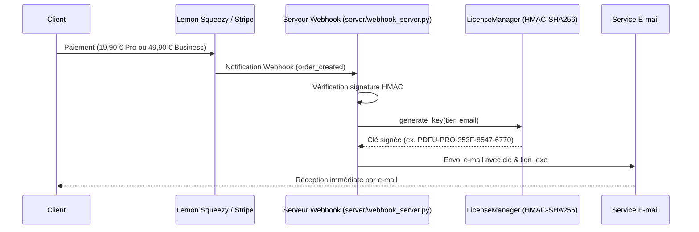

# Serveur d'Automatisation des Licences & Webhooks — PDF Unlocker

Ce module assure la **délivrance instantanée et 100 % automatisée** de clés de licence dès qu'un client achète une formule **Pro** ou **Business** sur votre boutique en ligne.

---

## ⚡ Fonctionnement du Flux



---

## 🚀 1. Tester Immédiatement en Local

Vous pouvez tester tout le flux (génération, journalisation, format d'e-mail) en une seule commande sans aucune configuration :

```powershell
python server/test_webhook.py --tier PRO --email client@domaine.com --name "Jean Dupont"
```

Pour simuler une commande **Business** :
```powershell
python server/test_webhook.py --tier BIZ --email cabinet@avocats.fr --name "Cabinet Legal"
```

---

## 🌐 2. Démarrer le Serveur Webhook

```powershell
python server/webhook_server.py
```

Le serveur écoute par défaut sur le port `8080` :
- `GET  /health` : Contrôle de santé (statut en ligne)
- `POST /webhook/lemonsqueezy` : Réception des commandes Lemon Squeezy
- `POST /webhook/stripe` : Réception des sessions Checkout Stripe
- `POST /webhook/gumroad` : Réception des ventes Gumroad

---

## ⚙️ 3. Configuration des Variables d'Environnement (Production)

Définissez ces variables sur votre hébergeur ou dans un fichier `.env` :

| Variable | Description | Exemple |
|---|---|---|
| `PORT` | Port d'écoute du serveur | `8080` |
| `WEBHOOK_SECRET` | Clé secrète de signature fournie par la plateforme de vente | `votre_secret_webhook_123` |
| `SMTP_HOST` | Serveur d'envoi d'e-mails (Resend, SendGrid, Brevo, Gmail...) | `smtp.resend.com` |
| `SMTP_PORT` | Port SMTP (généralement 587 avec STARTTLS) | `587` |
| `SMTP_USER` | Identifiant ou clé API SMTP | `resend` ou `apikey` |
| `SMTP_PASS` | Mot de passe ou clé secrète SMTP | `re_123456...` |
| `FROM_EMAIL` | Adresse d'expédition visible par le client | `commandes@pdfunlocker.com` |

> **Note :** Si `SMTP_HOST` n'est pas défini, le serveur fonctionne en **mode simulation sécurisé** (affiche l'e-mail dans la console sans bloquer).

---

## 📦 4. Configuration chez le Vendeur (ex. Lemon Squeezy)

1. Rendez-vous dans **Settings ➔ Webhooks** sur votre tableau de bord Lemon Squeezy.
2. Cliquez sur **Add Webhook**.
3. **URL de rappel** : `https://votre-domaine.com/webhook/lemonsqueezy`
4. **Secret** : Saisissez une chaîne aléatoire (à reporter dans `WEBHOOK_SECRET`).
5. **Événements à cocher** : Cochez uniquement `order_created`.
6. Enregistrez : chaque vente déclenchera automatiquement la génération et l'envoi de la clé !

